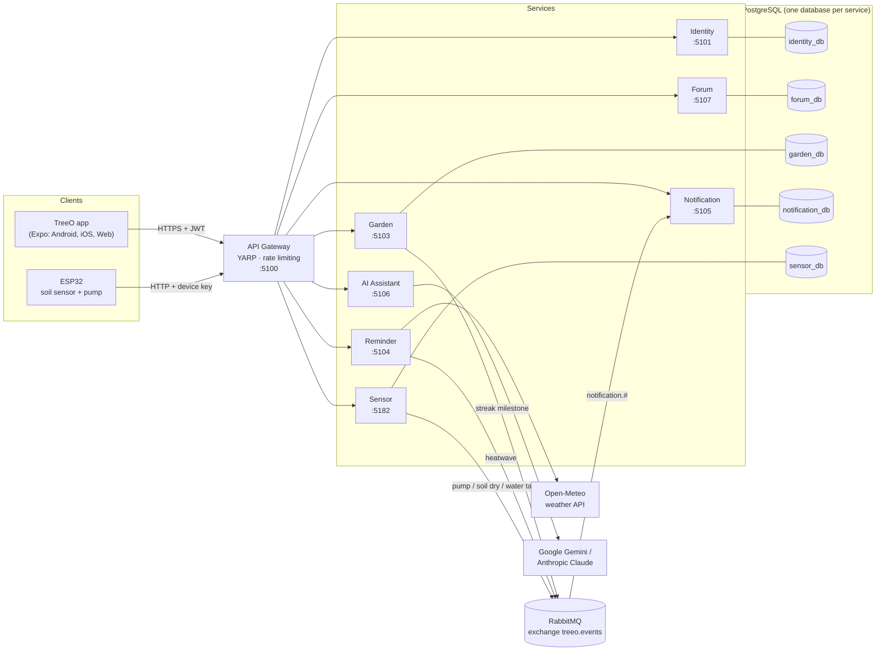

# TreeO – System Architecture

TreeO is a smart plant-care app for small desk and balcony plants. It is built as a set of independent microservices behind an API Gateway, with a React Native (Expo) client that runs on mobile and the web, and an ESP32 soil-moisture sensor with a water pump.

## 1. Overview

## 2. Services

| Service | Port (local) | Database | Responsibility | Owner |
|---|---|---|---|---|
| **API Gateway** | 5100 | – | Single entry point, routing, rate limiting, aggregated health | team |
| **Identity** | 5101 | identity_db | Register, login, JWT access + refresh tokens, roles (User / Expert / Admin), password change and reset | Tâm |
| **Forum** | 5107 | forum_db | Community posts, likes, follows, Verified Expert badge | Tâm |
| **Garden** | 5103 | garden_db | Daily watering streak (current, longest, 7-day view), milestone notifications | Thân |
| **Reminder** | 5104 | – | Weather from Open-Meteo (cached 10 min), heatwave detection and alerts | Thân |
| **Notification** | 5105 | notification_db | Consumes notification events from RabbitMQ, stores them, inbox API for the app | Thân |
| **AI Assistant** | 5106 | – | TreeO AI chat: Care Plan and Feng Shui modes (Gemini or Claude), 10 requests/min/user | Thân |
| **Sensor** | 5182 | sensor_db | ESP32 readings, device pairing, 24-hour history, "Water now" command, pump / dry-soil / water-tank notifications | Nguyên Lê |
| Plant Catalog | 5196 | (catalog_db) | Placeholder – not implemented, not routed, not deployed | – |

## 3. Key design decisions

**Database per service.** Each service owns its PostgreSQL database and no service reads another service's tables. They share one PostgreSQL server only to stay within the student budget; moving a database to its own server needs only a connection-string change.

**Stateless authentication with JWT.** Identity signs tokens (HMAC-SHA256). Every other service validates the signature, issuer, audience and expiry locally with the same key, so no service has to call Identity on each request. Access tokens last 60 minutes; refresh tokens last 7 days, are stored in identity_db and are revoked on logout and on password change. Passwords and reset codes are hashed with BCrypt.

**Asynchronous notifications through RabbitMQ.** Garden, Reminder and Sensor publish a `NotificationRequested` event (shared contract in `shared/TreeO.Contracts`) to the topic exchange `treeo.events` with routing key `notification.<type>`. Notification consumes the queue `notification.requests`. The publishers do not depend on Notification being up, and a `DedupKey` prevents duplicate notifications.

**API Gateway (YARP).** The app needs one base URL instead of seven. The gateway forwards requests unchanged (JWT and CORS are still handled by each service), applies rate limits (10 requests/min per IP on login, register and password reset; 300/min elsewhere), allows the AI route a longer timeout, and exposes `/health/all`, which checks every service.

**Device authentication.** The ESP32 has no user account, so it authenticates with its own device key in the `X-Device-Key` header. Only the SHA-256 hash is stored and keys are compared in constant time. Users pair a device by entering its ID and key in the app.

**Edge logic on the device.** The pump rules run on the ESP32 (hysteresis 30 % → 60 %, maximum 8 s per automatic run, 1 min rest, hard stop at 85 %), so plants are watered even when Wi-Fi or the server is down. The server sends settings and "Water now" commands in its reply to each reading (polling every 5 s), because the device sits behind a home router and cannot be called directly.

**Sensor data volume.** The device reports every 5 s, but the server stores a sample only when there is new information (≥ 3 % change, pump switch) or once a minute, which cuts about 17,000 rows per device per day to about 1,500. Data older than 30 days is deleted by a background job.

**Resilience.** A failed RabbitMQ publish never breaks the main action (watering, weather, readings). The publisher reconnects automatically. The app polls only while a screen is visible.

## 4. Main flows

### Login and an authenticated call
1. App → `POST /api/auth/login` (gateway, rate-limited) → Identity checks the BCrypt hash and returns access and refresh tokens.
2. App → `GET /api/garden/streak` with `Authorization: Bearer <token>` → Garden validates the JWT locally and answers.
3. When the access token is about to expire, the app calls `POST /api/auth/refresh` automatically.

### "Water now"
1. App → `POST /api/sensors/devices/{id}/water` → Sensor stores a pending command (valid for 60 s).
2. ESP32 → `POST /api/sensors/readings` (within 5 s) → the reply contains `pumpSeconds: 5` → the pump runs.
3. The ESP32 reports `pumpOn: true`, then `false` → Sensor records a `PumpRun` and publishes a `pump` event → Notification stores it.
4. The app sees the pump finish, shows the new moisture and calls `POST /api/garden/watering` to update the streak.

### Heatwave alert
App → `GET /api/weather` → Reminder fetches the forecast from Open-Meteo (cached) → if tomorrow reaches ≥ 35 °C, it publishes a `heatwave` event (deduplicated per user and day) → Notification.

## 5. Deployment

| Environment | How |
|---|---|
| Local development | `infra/docker-compose.yml` runs PostgreSQL and RabbitMQ; services run with `dotnet run` |
| Full system locally | `docker compose --profile app up -d --build`: every service in its own container |
| Production | GitHub Actions builds and tests on every push, pushes one image per service to GitHub Container Registry, and (optionally) deploys over SSH to a single VPS with `docker-compose.prod.yml`, where only the gateway is exposed |

Every service image uses a multi-stage build (SDK image to build, small ASP.NET runtime image to run) and runs as a non-root user. Configuration comes from environment variables; secrets are never stored in the repository (`dotnet user-secrets` locally, `infra/.env` on the server). See [DEPLOY.md](DEPLOY.md).

## 6. Technology

| Layer | Technology |
|---|---|
| Backend | .NET 10, ASP.NET Core Web API, Entity Framework Core + Npgsql |
| Gateway | YARP (Yet Another Reverse Proxy), ASP.NET Core rate limiting |
| Messaging | RabbitMQ 4 (topic exchange), RabbitMQ.Client 7 |
| Database | PostgreSQL 16 |
| Client | React Native + Expo (Expo Router), TypeScript, runs on Android, iOS and web |
| IoT | ESP32 (Arduino framework, PlatformIO), capacitive soil sensor, relay + mini pump, ArduinoJson |
| AI | Google Gemini (default) or Anthropic Claude |
| DevOps | Docker, Docker Compose, GitHub Actions, GitHub Container Registry |
| Tests | xUnit (pure-logic unit tests per service) |
